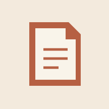
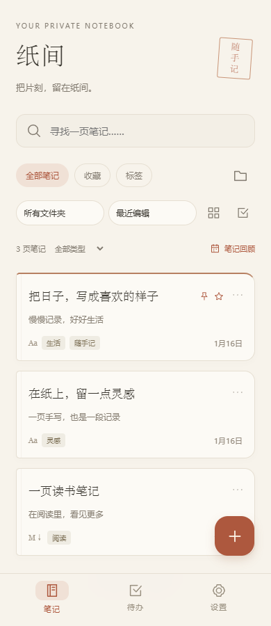
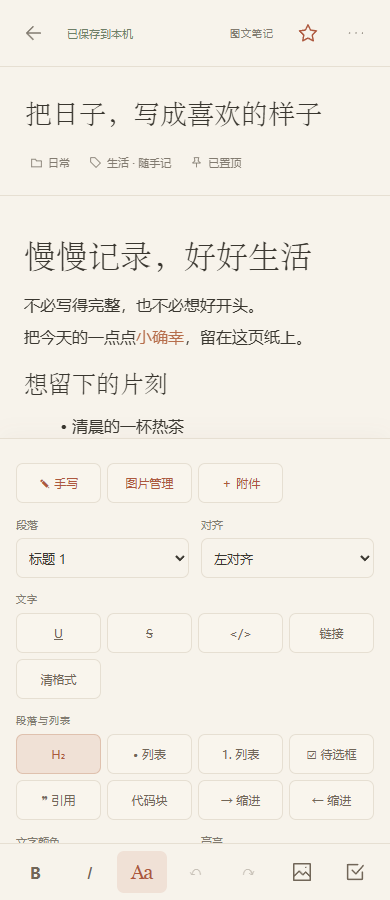
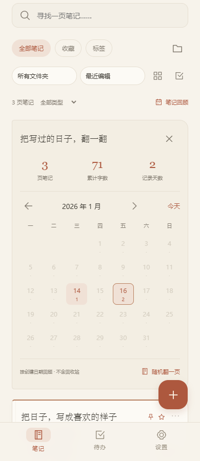
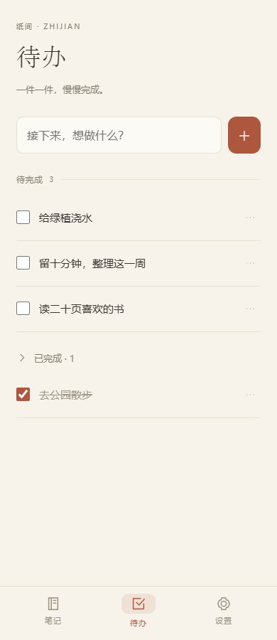
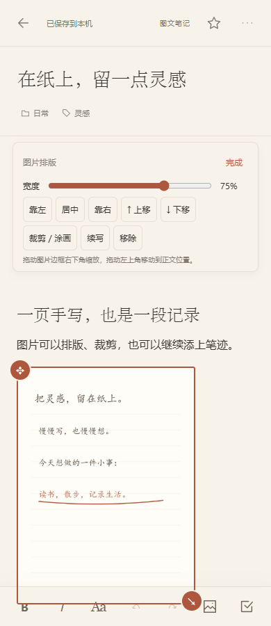
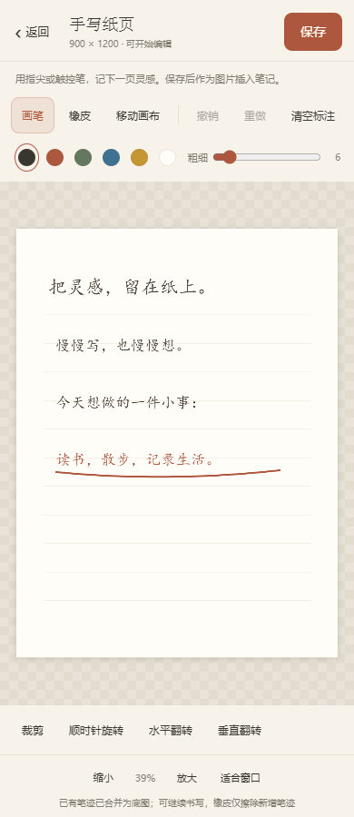

<p align="center"></p>
<h1 align="center">纸间 · Zhijian</h1>
<p align="center">把片刻，留在纸间。</p>
<p align="center">完全离线的 Android 笔记与待办应用，采用奶油纸色、陶土橙与书页式排版。</p>

**Android 8.0+ · 图文与 Markdown · 图片编辑与手写 · 无需账号 · 本地保存与备份**

## 界面预览

截图来自应用界面，使用虚构示例内容。

<table>
  <tr>
    <td align="center"><strong>笔记列表</strong><br></td>
    <td align="center"><strong>图文编辑</strong><br></td>
  </tr>
  <tr>
    <td align="center"><strong>日历回顾</strong><br></td>
    <td align="center"><strong>日常待办</strong><br></td>
  </tr>
  <tr>
    <td align="center"><strong>图片排版</strong><br></td>
    <td align="center"><strong>离线手写</strong><br></td>
  </tr>
</table>

## 能做什么

| 场景 | 功能 |
| --- | --- |
| 随手记录 | 图文笔记、Markdown 源码与预览、本地插图、自动保存和草稿恢复 |
| 轻松排版 | H1–H6、粗体/斜体/下划线/删除线、引用、代码、嵌套列表、待选清单、链接、颜色高亮、对齐与基础表格 |
| 图片与手写 | 图文内图片缩放、拖动和上下移动、对齐；裁剪、旋转、翻转、涂画；手指或触控笔书写、橡皮与撤销重做 |
| 长文与知识整理 | 笔记内查找替换、标题大纲、笔记链接与反向查找、五种内置模板与自定义模板 |
| 回到之前 | 自动保留修改版本，手动保存当前版本，预览并恢复标题、正文和文件附件 |
| 整理笔记 | 文件夹、标签、全文搜索、收藏与置顶、排序、列表/网格切换、批量移动和删除 |
| 找回内容 | 删除撤销、回收站全文只读查看、恢复和永久删除 |
| 日常回顾 | 创建日期日历、字数与记录天数统计、随机翻阅 |
| 记录事项 | 待办新增、修改、完成与重开、到期日期与本地通知提醒 |
| 收集资料 | PDF 等文件附件、交给本机阅读器打开，从其他应用分享文字、图片或文件到纸间 |
| 保存迁移 | 完整 ZIP 备份、合并恢复、笔记与图片的 Markdown ZIP 导出 |

## 开始使用

1. 首页点击「＋」，选择图文笔记或 Markdown。每条笔记保留各自的编辑类型。
2. 内容会自动保存，编辑页顶部显示保存状态。点击底部「Aa」展开格式面板，表格操作收纳在面板中的「表格」里。
3. 卡片右上角菜单可直接重命名、复制、移动或删除；长按卡片进入批量整理。
4. 在「设置」中备份、恢复或打开回收站；点回收站条目可查看完整内容。
5. 「Aa」面板可插入手写或文件附件。图文笔记中点图片可调整布局，点「裁剪 / 涂画」进入图片编辑；Markdown 可点预览中的图片编辑，或使用「图片管理」。
6. 右上角「笔记选项 → 笔记工具」提供查找替换、大纲、关联链接、历史与模板。新建笔记也可选择「从模板新建」。
7. 待办右侧菜单可设置日期与提醒。通知需要允许系统通知权限，省电策略可能使提醒稍有延迟。

安装已构建的 APK 时，按系统提示允许当前文件管理器安装应用。更新同一签名的版本可直接覆盖安装，保留已有记录。

## 离线与数据

应用不申请联网权限，无需账号，也不依赖服务器。界面、编辑器和预览所需资源均随安装包提供；笔记及图片保存在应用私有目录。外部图片不会自动加载，打开外部链接需要确认。

完整备份包含笔记、待办、文件夹、标签、图片、文件附件、历史版本、模板和回收站内容。恢复采用合并方式：相同内容跳过，有差异的同一条记录保留副本。换机或卸载前，请先在设置中保存 ZIP 备份。备份不加密，不使用系统云备份。

手写保存为 PNG，可重新打开继续添写；已有笔迹会合并为底图，橡皮只擦除本次新添笔迹。图片编辑另存新图，编辑画布最长边 2048 像素、总像素约 200 万；GIF 编辑后为静态 PNG。图片及文件附件每个最多 20 MiB；历史最多 12 版、合计约 1.5 MiB，较早版本会自动清理，不能代替完整备份。

支持 Android 8.0 及以上，需要系统 WebView。已验证 Android 16 模拟器离线运行及覆盖升级；其他系统版本和品牌设备的兼容性仍需更多反馈。

## 从源码构建

项目提供 Windows / PowerShell 构建脚本，推荐 JDK 17（也可使用 JDK 21），需要 PowerShell 7，并配置 `JAVA_HOME`。首次准备 Android SDK、Gradle 及构建依赖需要网络连接。

在项目根目录运行：

```powershell
.\scripts\setup.ps1
.\scripts\build.ps1 -Release
```

发布 APK 输出到 `dist/`。使用 `-Debug` 构建调试及安卓测试包。脚本也支持通过 `-JavaHome` 显式指定 JDK 目录；工具与缓存保存在 `.toolchain/`，不需要修改全局 Java 设置。

发布签名首次构建时保存在 `.signing/`，该目录已被 Git 忽略。请自行保管密钥，以便后续生成可覆盖升级的安装包。不同签名的安装包无法直接覆盖。

详细步骤见 [开发与测试](docs/development.md)。

## 文档

- [1.1.0 功能与设计参考](docs/1.1.0-改进说明.md)
- [1.2.0 图片、手写与实用工具](docs/1.2.0-改进说明.md)
- [数据格式与架构](docs/architecture.md)
- [验证记录与兼容范围](docs/verification.md)
- [仓库与版本发布](docs/publishing.md)
- [第三方许可](THIRD_PARTY_NOTICES.md)

图标由本项目的矢量路径绘制，界面使用系统字体。第三方组件的固定版本、来源与 SHA-256 记录在 [vendor-lock.json](vendor-lock.json)，运行时不从 CDN 加载。
